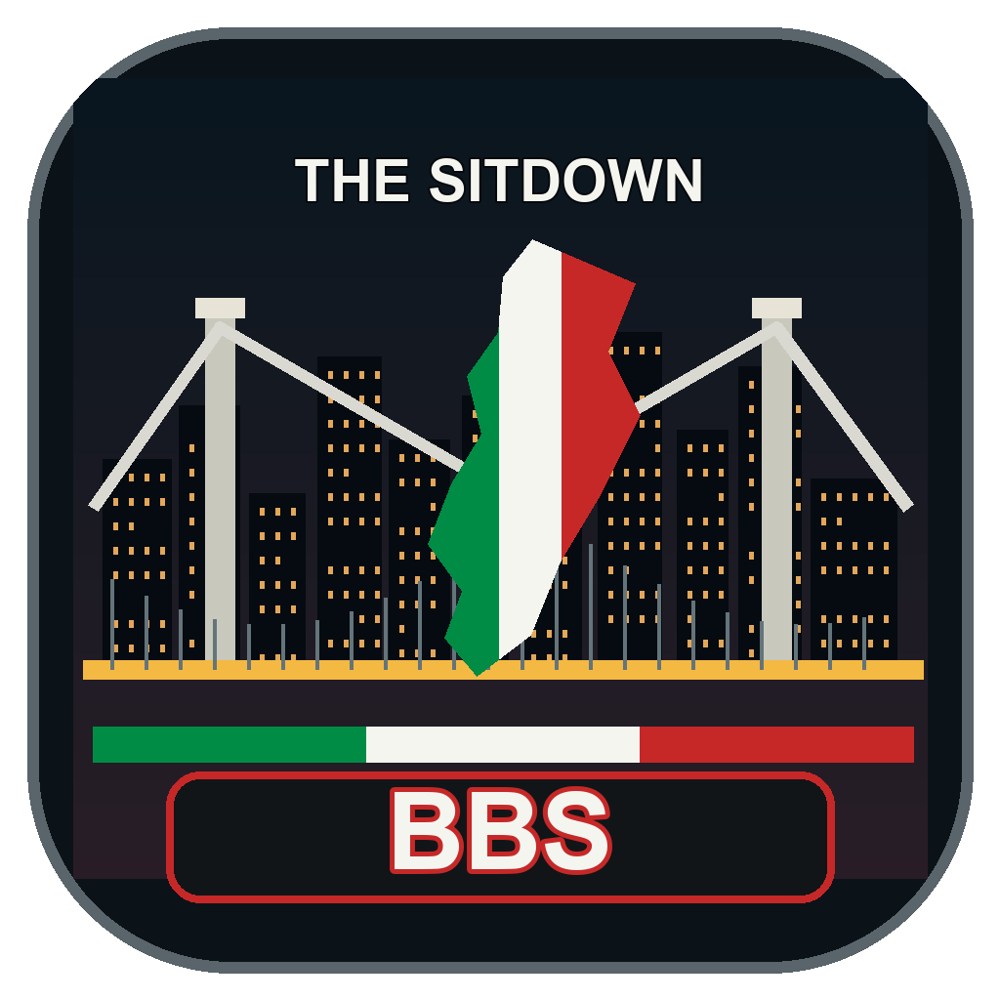
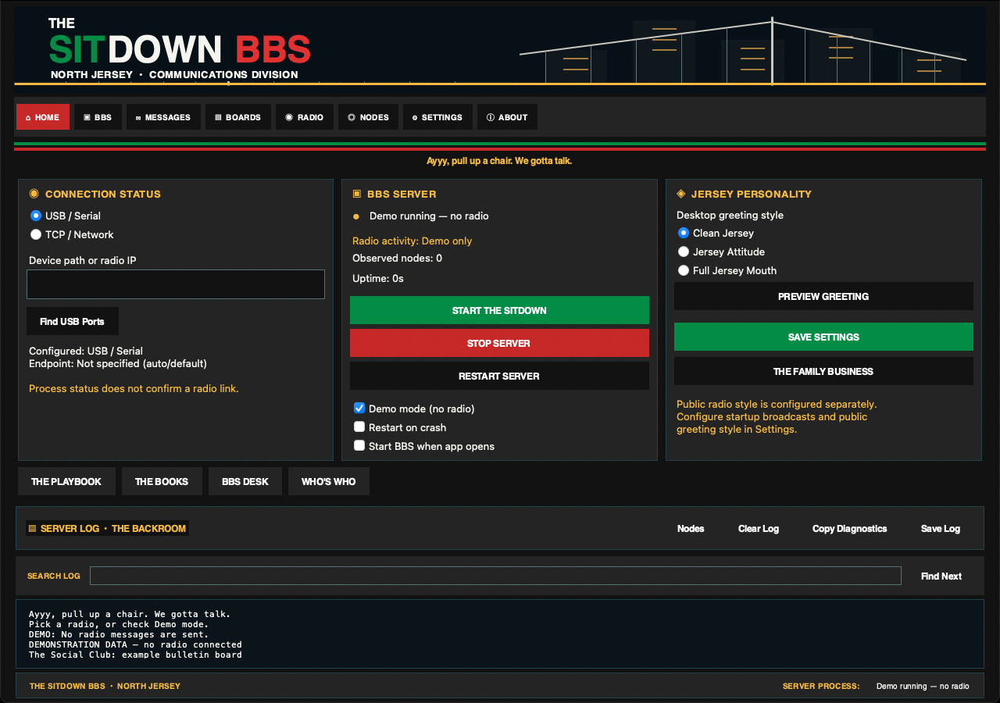
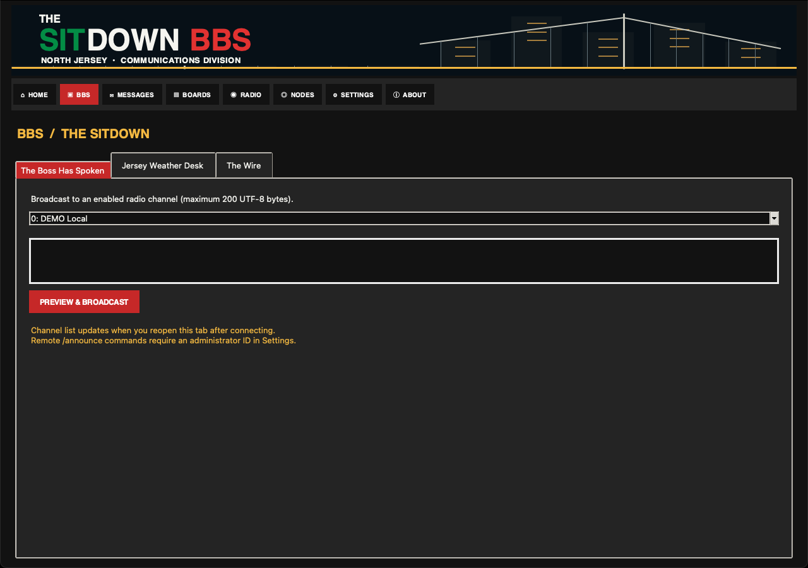
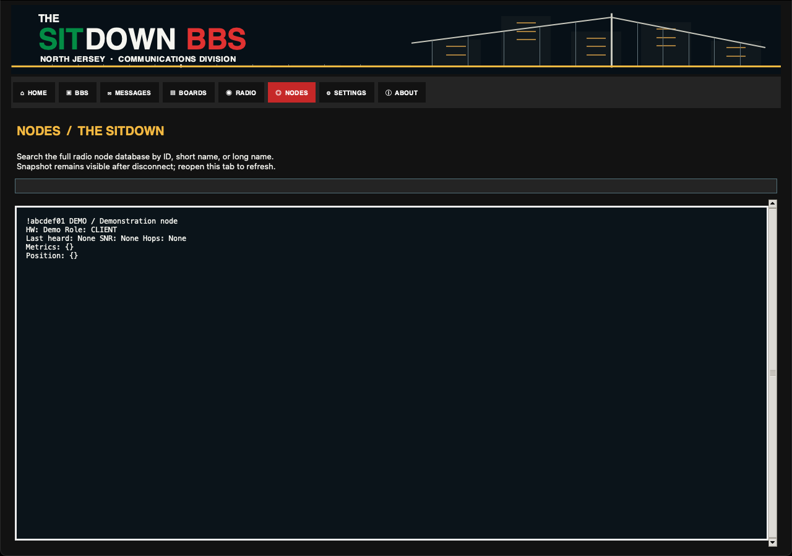
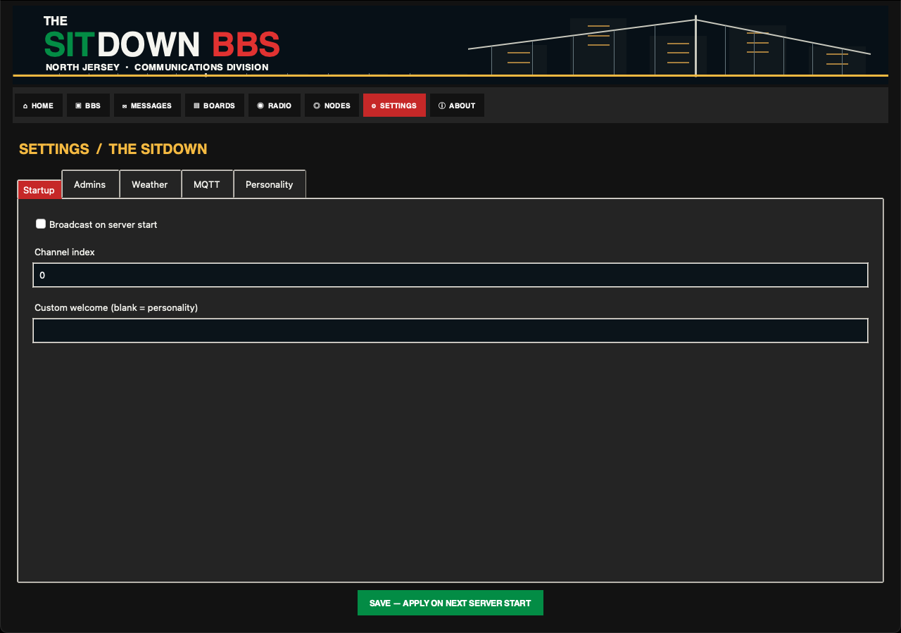

<div align="center">


## Jersey desktop and operator desks

The dashboard now has working tab pages for BBS utilities, local mail and boards,
radio status, full node lookup, settings, and About. Admin announcements and an
optional startup broadcast use the existing radio connection. Weather works with
an offline local report; internet weather and MQTT are separately **off by default**.

Read the [configuration and command guide](docs/JERSEY_DESK.md) and
[upstream audit](docs/UPSTREAM_AUDIT.md). This is a staged change: local utilities,
opt-in services, then desktop integration. Mac builds are test artifacts until
validated with a physical radio on an Intel Mac.




# 🤌 THE SITDOWN BBS
### 🇮🇹 North Jersey Communications Division 🇮🇹

**“Ayyy, pull up a chair. We gotta talk.”**

🖤 **Jersey Black** · ❤️ **Italian Red** · 💚 **Italian Green** · 🟡 **Diner Gold**

*A neighborhood social club for Meshtastic radio communications. Everybody's got connections.*

</div>

---

## 🥩 Welcome to the family

Around here, we don't just send messages. **We have sitdowns.**

**The Sitdown BBS** is a New Jersey–themed fork of the TC²-BBS Meshtastic bulletin board server. Send direct messages over Meshtastic to access community bulletins, mail, channel information, and utilities—no internet required for the radio link.

Think old-school bulletin boards with a North Jersey attitude: diner coffee, Sunday gravy, and the eternal **pork roll vs. Taylor ham** debate. Whatever exit you're from, there's a seat at the table.

> **Important:** This is an independent community project with a fictional Italian-American social-club theme. It is not affiliated with any television show.

## 📻 What's in the family business?

| Jersey name | What it does |
| --- | --- |
| 🥩 **The Social Club** | Bulletin boards and community posts |
| ✉️ **A Word With You** | BBS mail |
| 🗺️ **What Exit?** | Channel directory |
| 📊 **Who's Connected?** | Server utilities and statistics |
| 🔮 **Jersey Wisdom** | Random fortunes |
| 🖥️ **The Sitdown Desktop** | Tabbed desktop with server status, searchable logs, operator desks, and full node lookup |
| 🧪 **Demo Mode** | Explore desktop controls without connecting or transmitting over radio |
| 📦 **The Books** | Create a ZIP backup of available local settings and database files |

**Hardware verification (October 2026):** The Intel Mac desktop BBS launched and received a real Meshtastic message over TCP. The sending device confirmed receiving the BBS menu reply. The latest compact layout and radio activity indicator still require follow-up testing on the Mac. The activity indicator reflects incoming messages seen in server logs, not continuous link health.

**Development note:** The desktop dashboard includes live server logs, process monitoring, USB port discovery, optional process restart, and a radio-free demo mode. Intel Mac build and release workflows are configured; check [Releases](https://github.com/BaconDisk22/The-Sitdown-BBS/releases) for a successfully published build. Real radio connection verification, restore, and automated screenshot publication still require further validation.

## 🕵️ The Backroom — dashboard tools

The desktop launcher includes a few handy tools for keeping tabs on the family business:

| Control | What it does |
| --- | --- |
| **Find in Log / Find Next** | Search the visible server activity log and jump to matching entries |
| **Save Log** | Export the visible activity log as a UTF-8 text file for troubleshooting |
| **Clear Log** | Clear the visible log without stopping the BBS process |
| **Nodes / Who's Who** | Search the entire radio node database by ID or name, with available telemetry |
| **Refresh USB Ports** | List detected serial devices and fill in the port when exactly one is available |
| **Restart on crash** | Optionally restart the server process after an unexpected exit with capped exponential backoff |
| **Radio activity** | Reports incoming Meshtastic messages observed in BBS logs without claiming a permanent connection |

**Validation scope:** The earlier version's two-way TCP radio test is historical evidence only. These staged changes and their packaged app require a fresh Intel Mac/radio test. Node snapshots are not continuous presence checks; backups do not yet support restore.

### Jersey Mouth Control

Home provides **Clean Jersey**, **Jersey Attitude**, and **Full Jersey Mouth** greeting previews. Settings configures the generated startup broadcast greeting, with a separate public-profanity opt-in. Custom announcements, mail, and technical notices remain verbatim.

## 🤌 The Playbook — radio commands

Send these as **direct messages to the Meshtastic BBS node**.

| Command | Meaning |
| --- | --- |
| `/sitdown` or `/menu` | Back to the main menu |
| `/help` or `/ayyy` | Quick help |
| `/mail` or `/inbox` | Check your mail |
| `/boards` or `/socialclub` | Open the bulletin board |
| `/fortune` | Get a random fortune |
| `/tools` | Utilities |
| `/cancel` | Return to the main menu |
| `/node <ID or name>` | Full radio node lookup |
| `/weather` | Offline report or opt-in internet weather |
| `/wire` | Optional MQTT topic counts |
| `/announce <channel> <text>` | Administrator-only broadcast |

The original TC²-BBS one-letter menus and quick commands remain available alongside the Jersey shortcuts. More details: [SITDOWN_COMMANDS.md](SITDOWN_COMMANDS.md).

## 🖥️ Desktop preview (demonstration data)

**THE SITDOWN BBS — North Jersey Communications Division**

The current desktop dashboard uses Italian red and green accents, dark charcoal panels, and readable high-contrast controls. It includes **Start the Sitdown**, **Fuggedaboutit**, **The Playbook**, **The Family Business**, **The Books**, live searchable server logs, log export/clear controls, full node lookup, and a demo mode that does not require a connected radio.

**Demonstration data — no live radio connection.** The image below is captured automatically from the actual Tkinter dashboard on an Intel macOS GitHub Actions runner. It uses sample log entries, not real radio traffic. These screenshots come from the staged PR’s Intel Mac demo capture.



<details>
<summary>Operator desks, full node lookup, and opt-in settings (demo screenshots)</summary>





</details>

[Desktop screenshot automation](https://github.com/BaconDisk22/The-Sitdown-BBS/actions/workflows/readme-desktop-screenshot.yml) · [Intel Mac releases](https://github.com/BaconDisk22/The-Sitdown-BBS/releases)

### 📦 Download the latest Intel Mac build

[](https://github.com/BaconDisk22/The-Sitdown-BBS/actions/workflows/intel-mac-test-build.yml)

**[View GitHub Releases](https://github.com/BaconDisk22/The-Sitdown-BBS/releases)** · **[Download test builds from GitHub Actions](https://github.com/BaconDisk22/The-Sitdown-BBS/actions/workflows/intel-mac-test-build.yml)**

- **GitHub Releases:** Look for the latest `The-Sitdown-BBS-Intel-Mac-*.dmg` attached to a successful release.
- **GitHub Actions:** Open a successful **Intel Mac test build** run and download the **The-Sitdown-BBS-Intel-Mac-Test** artifact. Artifacts expire after 14 days.
- **Intel Mac:** The workflow targets x86-64 macOS. Builds are currently **unsigned and unnotarized**; approve trusted builds through macOS Privacy & Security if prompted.
- **Demo mode:** Launch the app and enable **Demo mode (no radio)** to explore the dashboard without transmitting.
- **Live radio:** Configure your Meshtastic device before starting the real BBS server. A running process alone does not confirm a connected radio.

For packaging details see [INTEL_MAC_TEST_BUILDS.md](INTEL_MAC_TEST_BUILDS.md), and for release instructions see [RELEASE_PROCESS.md](RELEASE_PROCESS.md).

### 🛠️ Run from source

Requires **Python 3 with Tkinter** and the dependencies in `requirements.txt`.

```bash
git clone https://github.com/BaconDisk22/The-Sitdown-BBS.git
cd The-Sitdown-BBS
python3 -m venv venv
source venv/bin/activate
pip install -r requirements.txt
cp example_config.ini config.ini
# Review config.ini before connecting a radio.
python3 sitdown_desktop.py
```

Select **Demo mode** to explore without a radio. For the headless server run `python3 server.py`.

## 🎨 Jersey colors, not Joker colors

| Role | Color |
| --- | --- |
| Background | `#121212` Jersey Black |
| Panels | `#242424` Charcoal |
| Primary actions | `#C62828` Italian Red |
| Connected / start | `#008C45` Italian Green |
| Text | `#F5F5F0` Mozzarella White |
| Highlights | `#F4B942` Diner Gold |

No purple, no Joker branding. Just Jersey.

## 🧪 Development and testing

```bash
python3 -m unittest discover -s tests -p 'test_sitdown_commands.py'
```

GitHub Actions also checks syntax and the command alias tests. Hardware validation is still required before calling a radio release production-ready.

## 🙏 Respect to the original crew

**The Sitdown BBS** is based on **TC²-BBS Meshtastic** by **TheCommsChannel (TC²)**. The original project provided the BBS architecture and Meshtastic integration; this fork adds its own Jersey theme, shortcuts, and desktop preview.

- [Original TC²-BBS-mesh project](https://github.com/TheCommsChannel/TC2-BBS-mesh)
- [Meshtastic](https://meshtastic.org/)
- [Python Meshtastic examples](https://github.com/meshtastic/python)
- [pdxlocations Meshtastic examples](https://github.com/pdxlocations/Meshtastic-Python-Examples)

**License:** GNU General Public License v3.0, consistent with the original project. Keep original copyright notices and license terms.

---

<div align="center">

### 🤌 “Fuggedaboutit. You're family now.”

**THE SITDOWN BBS** · *North Jersey Communications Division*

*Built for the mesh. Raised in Jersey.*

</div>
